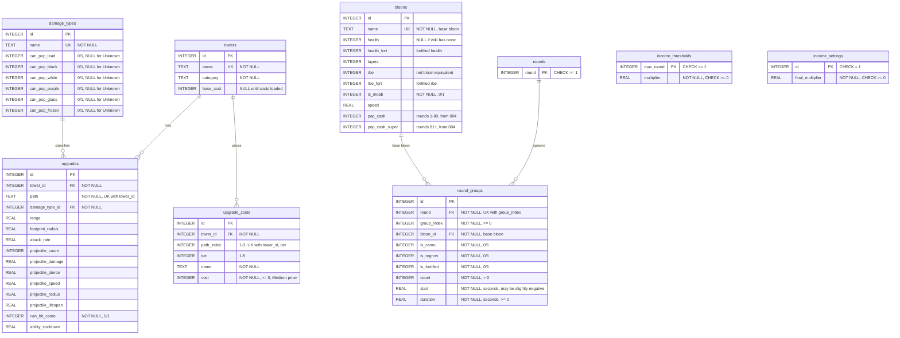

# Schema

Design for the SQLite database that the loader (Iain) fills and the query layer (Nicole) reads. DDL is in `btd6/db/migrations/001_initial.sql`; this file records the decisions behind it. `btd6.db.connect(path)` enables `PRAGMA foreign_keys = ON` and `sqlite3.Row`; `btd6.db.apply_migrations(connection)` applies unapplied migrations in numeric order, tracked by `PRAGMA user_version`. Never edit an applied migration.

## ER diagram



## Table definitions

### `towers`

| Column | Type | Null | Constraints |
|---|---|---|---|
| `id` | INTEGER | no | `PRIMARY KEY` |
| `name` | TEXT | no | `UNIQUE` (e.g. `Super Monkey`) |
| `category` | TEXT | no | (e.g. `Magic`) |
| `base_cost` | INTEGER | yes | Medium-difficulty price; added by `002_costs.sql`, NULL until costs are loaded |

### `upgrade_costs`

Added by `002_costs.sql`, filled by `btd6/db/cost_loader.py::load_costs` (idempotent, replaces one tower's rows). `btd6.costs.total_cost` sums them.

| Column | Type | Null | Constraints |
|---|---|---|---|
| `id` | INTEGER | no | `PRIMARY KEY` |
| `tower_id` | INTEGER | no | `REFERENCES towers (id)` |
| `path_index` | INTEGER | no | `CHECK BETWEEN 1 AND 3` |
| `tier` | INTEGER | no | `CHECK BETWEEN 1 AND 5` |
| `name` | TEXT | yes | upgrade name |
| `cost` | INTEGER | no | Medium price |

`UNIQUE (tower_id, path_index, tier)`.

### `bloons`, `rounds`, `round_groups`

Added by `003_rounds.sql`. Row keys of the loader (`extract_bloon_rows`, `tests/isp-tables/bloons.md`): `name, health, health_fort, layers, rbe, rbe_fort, is_moab, speed`.

| Table.column | Type | Null | Constraints |
|---|---|---|---|
| `bloons.id` | INTEGER | no | `PRIMARY KEY` |
| `bloons.name` | TEXT | no | `UNIQUE`; base names only, taken from the Cargo `id` (`Red`, `Moab`, `Ddt`, `Zomg`, `Bad`) so they match roundset base names |
| `bloons.health`, `health_fort`, `layers`, `rbe`, `rbe_fort` | INTEGER | yes | `CHECK (x IS NULL OR x >= 0)` |
| `bloons.is_moab` | INTEGER | no | `CHECK (is_moab IN (0, 1))` |
| `bloons.speed` | REAL | yes | `CHECK (speed IS NULL OR speed >= 0)` |
| `rounds.round` | INTEGER | no | `PRIMARY KEY`, `CHECK (round >= 1)` |
| `round_groups.id` | INTEGER | no | `PRIMARY KEY` |
| `round_groups.round` | INTEGER | no | `REFERENCES rounds (round) ON DELETE CASCADE` |
| `round_groups.group_index` | INTEGER | no | `CHECK (group_index >= 0)`; `UNIQUE (round, group_index)` |
| `round_groups.bloon_id` | INTEGER | no | `REFERENCES bloons (id)` (no cascade: a bloon in use cannot be deleted) |
| `round_groups.is_camo`, `is_regrow`, `is_fortified` | INTEGER | no | `CHECK (x IN (0, 1))` |
| `round_groups.count` | INTEGER | no | `CHECK (count > 0)` |
| `round_groups.start` | REAL | no | seconds; no CHECK, the wiki has one `-0.15` (round 86) |
| `round_groups.duration` | REAL | no | `CHECK (duration >= 0)`, seconds |

Indexes: `idx_round_groups_round` (the per-round lookup the income and round views use; it duplicates the prefix of the `UNIQUE (round, group_index)` autoindex, kept explicit so the lookup does not depend on the uniqueness constraint) and `idx_round_groups_bloon_id` (foreign key; SQLite does not index it, and it speeds "which rounds contain bloon X" and the `bloons` delete check). Both are checked in `tests/test_db_indexes.py`.

Modifier parsing rule: a roundset bloon name is a base name followed by any of the suffixes in no fixed order (`CeramicRegrowFortifiedCamo`, `DdtFortifiedCamo`). The loader strips the case-sensitive suffixes `Fortified`, `Camo` and `Regrow` from the end of the name, repeatedly and in any order, until none is left; each stripped suffix sets `is_fortified`, `is_camo` or `is_regrow` on the group. The remainder is the base name and is looked up in `bloons.name` to give `bloon_id` (it must not be empty). The rule is textual and does not check that the combination exists in the game. Example: `CeramicRegrowFortifiedCamo` -> base `Ceramic`, regrow, fortified, camo. Implemented by `split_bloon_name` in `btd6/etl/extract.py`.

### `income_thresholds`, `income_settings` and `bloons.pop_cash*`

Added by `004_income.sql` (epic #89; rules in `docs/income.md`).

| Column | Type | NULL | Constraint / notes |
|---|---|---|---|
| `bloons.pop_cash` | INTEGER | yes | `CHECK (x IS NULL OR x >= 0)`; cash for fully popping one bloon in rounds 1-80, computed by the ETL from the Cargo `parent of` field |
| `bloons.pop_cash_super` | INTEGER | yes | same, for rounds 81+ (one child per non-MOAB bloon, Super Ceramic pays 87) |
| `income_thresholds.max_round` | INTEGER | no | `PRIMARY KEY`, `CHECK (max_round >= 1)`; last round the multiplier applies to |
| `income_thresholds.multiplier` | REAL | no | `CHECK (multiplier >= 0)` |
| `income_settings.id` | INTEGER | no | `PRIMARY KEY CHECK (id = 1)`: single row |
| `income_settings.final_multiplier` | REAL | no | `CHECK (final_multiplier >= 0)`; applies above the last threshold |

Loaded by `load_income` in `btd6/db/round_loader.py` (replaces all rows in one transaction, so reloads are idempotent).

### `damage_types`

| Column | Type | Null | Constraints |
|---|---|---|---|
| `id` | INTEGER | no | `PRIMARY KEY` |
| `name` | TEXT | no | `UNIQUE` |
| `can_pop_lead`, `can_pop_black`, `can_pop_white`, `can_pop_purple`, `can_pop_glass`, `can_pop_frozen` | INTEGER | yes, only for `Unknown` | `CHECK (x IS NULL OR x IN (0, 1))` |

Seeded in the migration from `DAMAGE_TYPES`: ids 1 to 11 follow `DAMAGE_TYPES` order (not the mask values; Normal, Shatter, Explosion, Glacier, Cold, Fire, Frigid, Sharp, Acid, Plasma, Energy), plus `Unknown` as id 12. Ids are stable but not ordered (a type added later gets id 13 or more), so the loader looks a type up by `name`, never by bitmask.

### `upgrades`

| Column | Type | Null | Constraints |
|---|---|---|---|
| `id` | INTEGER | no | `PRIMARY KEY` |
| `tower_id` | INTEGER | no | `REFERENCES towers (id) ON DELETE CASCADE` |
| `path` | TEXT | no | `CHECK (path GLOB '[0-5]-[0-5]-[0-5]')`; `UNIQUE (tower_id, path)` |
| `damage_type_id` | INTEGER | no | `REFERENCES damage_types (id)` |
| `range`, `footprint_radius`, `attack_rate`, `projectile_damage`, `projectile_pierce`, `projectile_speed`, `projectile_radius`, `projectile_lifespan`, `ability_cooldown` | REAL | yes | `CHECK (x IS NULL OR x >= 0)` |
| `projectile_count` | INTEGER | yes | `CHECK (projectile_count IS NULL OR projectile_count >= 0)` |
| `can_hit_camo` | INTEGER | no | `CHECK (can_hit_camo IN (0, 1))` |

### Indexes

| Index | Justification |
|---|---|
| `UNIQUE (tower_id, path)` (automatic) | Natural key and loader upsert target; also serves "upgrades of one tower" |
| `idx_upgrades_damage_type_id` | Foreign key (SQLite does not index it) and the `damage_type` filter |
| `idx_upgrades_range` | `min_range` filter |
| `idx_upgrades_projectile_pierce` | `min_pierce` filter |
| `idx_upgrades_projectile_damage` | `min_damage` filter |

None on `can_hit_camo` (0/1 is not selective enough), on `projectile_speed` (a threshold filter, but no index was justified at about 320 rows) or on the sort columns (`NULLS LAST` with a tiebreak needs a sort regardless).

`EXPLAIN QUERY PLAN` output (36 sample rows; the real data is a few hundred, after `ANALYZE`; enforced by `tests/test_db_indexes.py`):

```
WHERE projectile_pierce >= 5   SEARCH upgrades USING COVERING INDEX idx_upgrades_projectile_pierce (projectile_pierce>?)
WHERE projectile_damage >= 5   SEARCH upgrades USING COVERING INDEX idx_upgrades_projectile_damage (projectile_damage>?)
WHERE range >= 50              SEARCH upgrades USING COVERING INDEX idx_upgrades_range (range>?)
WHERE damage_type_id = 3       SEARCH upgrades USING COVERING INDEX idx_upgrades_damage_type_id (damage_type_id=?)
WHERE tower_id = 1 AND path=.. SEARCH upgrades USING COVERING INDEX sqlite_autoindex_upgrades_1 (tower_id=? AND path=?)
WHERE can_hit_camo = 1         SCAN upgrades   (deliberate: two values, an index would not help)
```

Indexes live in `001_initial.sql` rather than a separate `002_indexes.sql` because the schema had not shipped yet; later changes use new numbered migrations.

### Seeding

`001_initial.sql` seeds `damage_types` so a migrated database is usable. `btd6.db.seed.seed_lookup_tables` re-derives the same rows from `DAMAGE_TYPES` (an upsert on `name`), so a type added in code appears without editing SQL; existing ids never change, and a new type gets the next free id. `initialize_database` migrates then seeds. `tests/test_db_seed.py` checks the code-derived flags for every entry, which guards against the migration drifting from `DAMAGE_TYPES`.

`btd6.db.connect(database_path=None)` lives in `btd6/db/connection.py`; `None` means the file `btd6.db` in the project root.

## `extract_row` mapping

Every one of the 19 columns of `extract_row`'s output has a destination.

| `extract_row` column | Destination |
|---|---|
| `path` | `upgrades.path` |
| `range`, `footprint_radius`, `attack_rate`, `projectile_count`, `projectile_damage`, `projectile_pierce`, `projectile_speed`, `projectile_radius`, `projectile_lifespan`, `ability_cooldown` | the `upgrades` column of the same name |
| `can_hit_camo` | `upgrades.can_hit_camo` (bool stored as 0/1) |
| `damage_type` | looked up by name in `damage_types`, stored as `upgrades.damage_type_id` |
| `can_pop_lead`, `can_pop_black`, `can_pop_white`, `can_pop_purple`, `can_pop_glass`, `can_pop_frozen` | deliberately not stored on `upgrades`: they are columns of `damage_types`, reached through `damage_type_id` (see the `can_pop_*` decision) |

`extract_row` returns no tower or category, so the loader supplies `towers.name` and `towers.category` from its own input.

## Decisions

### Key: surrogate `id` plus `UNIQUE (tower_id, path)`

`upgrades.id INTEGER PRIMARY KEY` is the primary key, and `(tower_id, path)` is the natural key, enforced `UNIQUE` and used as the loader's upsert target. A composite primary key would also work. We chose the surrogate because later child tables (2.0 cost and round data) can then reference one integer instead of a pair. The natural key is still enforced, so nothing is lost. The primary keys are named `id` rather than `tower_id` and `damage_type_id`, which matches `docs/queries.md`; foreign key columns carry the table prefix.

### `can_pop_*`: derived through `damage_types`

Each flag is a function of the damage type, so storing it per upgrade would be a transitive dependency (not 3NF), would repeat the same six values on hundreds of rows, and could drift from `damage_type_id`. The flags live in `damage_types`, seeded once, and `search_upgrades` reaches them through the join it already needs for `damage_type`. The loader maps `extract_row`'s `damage_type` name to `damage_type_id` and ignores the row's `can_pop_*` values. The cost is one join on lead and similar filters, which is small because `damage_types` has 12 rows.

### Boolean storage: `INTEGER` 0/1 with `CHECK`

SQLite has no boolean type. Every boolean column is `INTEGER` with `CHECK (x IN (0, 1))` (nullable variant for the `Unknown` flags). The loader converts pandas `numpy.bool_` to `int` before binding, because `sqlite3` cannot bind `numpy.bool_`.

### NULL: "no value for this upgrade"

- Stat columns (`range`, `footprint_radius`, `attack_rate`, `projectile_*`) are `NULL` when the wiki data has no value, such as a tower with no attack or no projectile. Never store `0` as a stand-in, because `0` is a real value and a valid filter threshold.
- `ability_cooldown` is `NULL` for an upgrade with no ability.
- `can_pop_*` on `damage_types` is `NULL` only for `Unknown`: an unmapped bitmask says nothing about what can be popped. A comparison against `NULL` matches neither `True` nor `False`.
- `can_hit_camo`, `tower_id`, `path` and `damage_type_id` are never `NULL`.
- A filter on a nullable column never matches `NULL`, so `min_pierce=0` excludes upgrades with no pierce (`docs/queries.md`).

### Normalization

Tower name and category are stored once in `towers`, and damage type name and flags once in `damage_types`, so no string is repeated per upgrade. There is no deliberate duplication: `can_hit_camo` is a fact about the upgrade's projectile and cannot be derived from another column.

### Loader (`btd6/db/loader.py`)

`load_tower(connection, tower_name, resolved, category="Magic")` rebuilds one tower: in one transaction it ensures the `towers` row (`ensure_tower`, idempotent), deletes that tower's upgrades and inserts the new ones, so upgrades that vanished from the wiki data are removed and other towers are untouched. Any failure rolls back everything, including a newly created tower row. `damage_type` is looked up by name (falling back to `Unknown`), booleans become 0/1, `None` stays `NULL`, and `can_pop_*` are ignored. It returns the number of upgrades written (`len(resolved)`).

### Known limitations

- `extract_row` keeps only the first attack, first projectile and first ability of each upgrade. The Super Monkey data has no upgrade with more than one attack, so nothing is lost today. Towers with several attacks need an `attacks` table (2.0, "stats per attack"); splitting later means a data migration.
- `can_pop_*` are six columns on `damage_types` rather than a `bloon_properties` plus junction table. A junction table is the fully normal form, but it needs a join per flag; with six fixed properties the single join was preferred.
- Migrations run inside one transaction, so they must not contain `BEGIN`/`COMMIT` or toggle `PRAGMA foreign_keys` (a no-op in a transaction); table rebuilds need another approach. `apply_migrations` also assumes one process at a time.
- Seed rows for a removed `DAMAGE_TYPES` entry are not deleted, and a wrong flag in the migration is overwritten silently by the seed (the drift test guards this).
- `projectile_count` is `INTEGER` (a count); the other projectile stats are `REAL`.
- `projectile_speed` has no index and neither do the sort columns: at a few hundred rows SQLite scans anyway, and `NULLS LAST` with a tiebreak needs a sort regardless.
- The `path` check allows `5-5-5`; real upgrades have at most two non-zero tiers and the loader is the place to validate that.

### Cost in 2.0

Costs arrive in `002_costs.sql`: `towers.base_cost` (nullable until costs are loaded) and a separate `upgrade_costs` table keyed by `(tower_id, path_index, tier)`. The wiki prices each tier of each path, not each `X-Y-Z` crosspath, so a column on `upgrades` would repeat the same tier price across every crosspath that contains it. The cumulative cost of a crosspath is computed by `btd6.costs.total_cost`. Prices are stored at Medium; the difficulty multiplier is applied in code. `upgrade_costs.tower_id` cascades on delete, like `upgrades.tower_id`.

### Rounds in 2.0

- Bloon modifiers are flags on `round_groups`, not rows in `bloons`: `bloons` holds the 20 or so base types once, so `RedCamo` and `Red` share health and speed, and a group stores only what the round changes. Storing every combination in `bloons` would duplicate stats and invent combinations that do not exist.
- `rounds` holds only the round number. It exists so `round_groups.round` has a foreign key target and a round with no groups (if one ever appears) is representable; deleting a round cascades to its groups (a reload replaces a round's groups).
- `(round, group_index)` is the natural key (`group_index` is the position of the group in the wiki's roundset, so the spawn order is kept); `id` is a surrogate like `upgrades.id`.
- `health_fort` and `rbe_fort` are stored, not computed, because the wiki gives them and fortified health is not a fixed multiple of normal health across bloon types. They are `NULL` when the wiki has no value (for example MOAB-class bloons), never `0`.
- `is_moab` is `NOT NULL`; an empty wiki value becomes `0` in `extract_bloon_rows`.
- `start` and `duration` are seconds as `REAL`; `count` is the number of bloons in the group.
- Income per round is not stored: it is derived from groups and `bloons.pop_cash` / `pop_cash_super` in `btd6/income.py`.
- `finalMultiplier` lives in the single-row `income_settings` table instead of a sentinel `max_round` in `income_thresholds`: a sentinel would be a fake round number that every query has to special-case, and `max_round` stays a real round.
- Pop cash is stored per bloon (two columns) rather than as a `bloon_children` edge table: the only consumer is income, the values are fixed by the wiki tree, and storing them keeps the per-round income a single `SUM` over `round_groups`.

## Queries this must support

Taken from `docs/queries.md`. Pending sign-off from Nicole.

1. Upgrades of one tower (`towers.name`) or one category (`towers.category`).
2. Upgrades that can or cannot pop a bloon property (lead, black, white, purple, glass, frozen), through `damage_types`.
3. Upgrades with at least a given range, pierce, projectile damage or projectile speed; `NULL` never matches.
4. Upgrades with a given damage type (`damage_types.name`), exact and case-sensitive, and the list of valid names for the error message.
5. Upgrades that can or cannot hit camo.
6. Any combination of the above, ANDed.
7. Sorting by `range`, `attack_rate`, `projectile_damage`, `projectile_pierce`, `projectile_speed`, `projectile_count` or `ability_cooldown`, `NULL` last, ties by tower name then path.
8. Limiting the number of rows returned.
